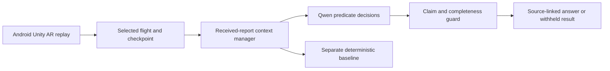

# ApronLens

[](https://github.com/MayFairMI6/apron-lens/actions/workflows/checks.yml)

ApronLens is a smartphone AR research prototype investigating how an assistant
maintains shared context when users refer to objects, correct earlier intent,
and receive new information between conversational turns. Aviation is the
application domain: moving aircraft, flight rotations and changing stand reports
provide a controlled environment for studying spatial and temporal context.

The current application direction is **controller situational-awareness training**.
Three exercises cover an obstructed ground route, an occupied arrival stand and a changing
departure estimate. Each has a briefing, moving aircraft, a report-grounded assistant,
three scored formative checkpoints and an evidence debrief. Pilot and turnaround perspectives
support the debrief; separate courses and cockpit procedures are outside this milestone.
The iOS preview has landscape and portrait layouts, an elevated overview and selectable
aircraft. A local external service owns time and offers a short lesson, a normal-speed hour,
or a guided 30× demonstration that slows for teaching moments and actual assistant responses.
Models, baselines and playback controls are absent from the learner interface. Earlier
turnaround/printed-board builds and frozen research results remain historical baselines.
The longer guided story includes a reported runway wildlife hold, takeoff and landing,
measured paved taxi turns and a separate engine fire after parking. Aircraft movements,
visual incidents and their reports follow the same external clock. Heathrow/CAA publications
inform the reporting distinctions; the layout and event timings remain fictional.
See [training setup and limits](docs/TRAINING_DRIVER.md) and the
[Heathrow scenario sources](docs/HEATHROW_SCENARIO_BASIS.txt).

Start the current controller lesson with
`.venv-candidates/bin/python -m backend.training --mode lesson --exercise surface_conflict --seed 17`.
The preselected local Qwen3.5-9B configuration is unchanged. Continuous voice, full Heathrow
reconstruction and physical-device AR testing remain separate work. The shared-backbone
extension and recorded-video experiment are deferred by the current priority decision.

For the frozen Checkpoint 1 demonstration, start with the
[current setup and verification record](docs/course/CHECKPOINT1_CURRENT.md),
[presenter guide](docs/course/CHECKPOINT1_PRESENTER_GUIDE.txt) and
[course documentation status](docs/course/README.md).
The recorded guided run is an iOS Simulator preview; physical-device AR tracking
and measured visual reasoning are not demonstrated by that recording.

**This repository contains the editable Unity application**, its local Qwen service,
synthetic datasets, and preserved evaluation records. The historical Android app places
original 3D aircraft over a printed fictional airfield board using Vuforia.


*Actual Unity renders in an illustrative Galaxy S24 outline. Physical phone,
keyboard and AR tracking tests remain pending.*

[Download Android APK](https://github.com/MayFairMI6/apron-lens/releases/tag/v0.1.1)
· [Unity setup](docs/UNITY_SETUP.md)
· [Model and GitHub workflow](docs/MODEL_WORKFLOW.md)
· [Evaluation report](outputs/reasoning_v2/REPORT.md)

## Conversational research and historical proposal

The completed [M1 conversational-context study](outputs/m1_ar_context/REPORT.md)
evaluated 40 held-out turns in 17 families, across three context conditions, with
images off. Qwen3.5-9B scored 24/40 in full AR; Qwen3-VL-4B and the deterministic
baseline each scored 16/40. These are frozen earlier-method results, not a new
evaluation of the controller interface or its training selector. The current
demo uses image-bearing requests but answers by selecting report facts; it does
not establish visual recognition accuracy. [M2 visual-evidence work](docs/AR_SCOPE.md)
remains planned.

The proposal discussion below records earlier research plans. For current
completion status use the M1 report and Checkpoint 1 guide above; planned
capabilities and hosted-model candidates are not additional delivered results.

**Question:** How should an AR assistant maintain and revise shared context when
user corrections and external event updates arrive between conversational turns?

A proposed interaction: select an aircraft, ask “Why is this one waiting?”,
clarify “I mean its next rotation”, and then inspect a delayed report that
changes the answer. The assistant should retain the corrected reference,
re-evaluate applicable evidence and explain the change using its sources.
This conversational interaction is proposed; the released app currently uses
explicit aircraft selection and fixed report queries.

The research focus is shared spatial reference, revisable conversation memory,
and the distinction between user intent and source-backed external facts.
Longitudinal context across rotations or resumed sessions is a separate planned
extension. Adaptive model/effort routing, caching and proactive assistance follow
controlled evaluation of the core interaction.

| Capability | Status |
|---|---|
| Aircraft replay, selected-flight reports and source inspection | Implemented |
| Local Qwen report selection and separate deterministic baseline | Implemented and evaluated on synthetic structured queries |
| Follow-up dialogue, reference resolution and correction memory | Proposed |
| Visually necessary reasoning and linked-session context | Proposed |
| Hosted APIs, adaptive effort and cache/compaction experiments | Proposed |
| Proactive notifications when evidence changes an earlier answer | Proposed |

[Research plan and literature](RESEARCH_PLAN.md) describes the comparisons,
evaluation design and boundaries of current evidence. The historical structured
benchmark establishes a foundation; it does not evaluate the proposed dialogue.

## Historical Android application

- Scripted aircraft motion with pause, restart, seek and tracking-loss gating.
- **Now / Why / History** views, selected-flight scope and source inspection.
- Separate event and receipt times: a delayed report appears only after receipt.
- Local Qwen evidence selection with exact source references and visible unknowns.
- Explicit current, latest and change-history query types in the backend/harness.
- A deterministic baseline displayed and evaluated separately from Qwen.
- Android ARM64 development build and simulated base Galaxy S24 layout checks.

The app currently has one authored stand-coordination replay. Additional evaluation scenarios
run in the Python harness; there is no Android scenario picker yet. Coordination
updates are A-CDM-inspired, but no live airport/A-CDM feed is connected. This is a
fictional research prototype without movement authority or validated collision
protection. The benefit of AR over a conventional screen remains to be tested.

## Start with the Unity app

1. Clone this repository with GitHub Desktop or Git.
2. Install **Unity 6000.2.2f1**, Android Build Support, SDK/NDK and OpenJDK.
3. Obtain **Vuforia Engine 11.4.4** from its official distribution. Place the
   licensed package at `unity/SurfaceSafetyCoach/Packages/com.ptc.vuforia.engine-11.4.4.tgz`
   before opening the project. The package is excluded from Git.
4. Open `unity/SurfaceSafetyCoach` through Unity Hub. Add your own Vuforia
   application license in the Vuforia configuration; its local asset is ignored.
5. Open `Assets/SurfaceSafety/Scenes/DesktopReplay.unity` and press Play for a
   camera-free preview. For the phone, build `AndroidAR.unity` for Android.
6. Print [the original board](media/airport-board.png)
   at **24 × 16 cm**, without scaling, and measure it. The target width is 0.24 m.

The replay and recorded-fact views work without Qwen. For **Why → Qwen → Explain**,
start the Python service below. See [Unity setup](docs/UNITY_SETUP.md) for build,
phone networking and physical acceptance checks.

## Start the local model service

Verified development machine: Apple Silicon Mac, 48 GB memory, Python 3.12,
MPS float16. Qwen runs on the Mac; the smartphone is the AR interface. The
current engine chooses an NVIDIA GPU, then MPS, then CPU. USF students can run
model checks on the GAIVI GPU cluster; see [Running on GAIVI](docs/GAIVI.md).

```sh
python3.12 -m venv .venv-qwen
source .venv-qwen/bin/activate
python -m pip install -r requirements-qwen.lock.txt
python scripts/download_qwen.py
bash scripts/start_qwen_server.sh
```

The downloader uses the exact revision in [config/model-manifest.json](config/model-manifest.json).
It does not follow the latest upstream model. Weights stay in ignored `models/`.
Newer Qwen3-VL, Qwen3.5 and Gemma 4 models can be tried for development comparisons;
see [Try a candidate model](docs/MODEL_WORKFLOW.md#try-a-candidate-model).
The service generates a local connection token in `work/qwen-server-token.txt`;
enter it through **More → Model connection**. Keep that token local.

For a phone on USB, use `adb reverse tcp:8765 tcp:8765` and the default service
address. For a trusted Wi-Fi connection, follow [QWEN_CONNECTION.md](QWEN_CONNECTION.md).

## Implemented report reasoning



Code filters reports by receipt time and identity and supplies temporal status
labels. Qwen selects literal predicates through short Yes/No decisions; the
pipeline composes missing-evidence flags and projects exact values/source links
from the selected records. The guard withholds an incomplete or incorrect
selection; it never silently replaces it with a baseline answer.

The production report-query path uses text. A synthetic scene image is captured
for audit but supplies no service-state evidence. Multi-frame visual reasoning,
visually necessary tasks and longitudinal memory remain research extensions.
No model fine-tuning has been performed.

## Proposed model/API strategy

Keep local Qwen and the deterministic resolver as reproducible baselines. Test
OpenAI Responses with Astra on selected difficult turns and reference evaluations;
benchmark a lower-cost model for routine dialogue. Claude is a cross-provider
comparison, DeepSeek Flash a further multimodal candidate, and Gemini an optional
comparison if video becomes necessary. Hosted adapters are not implemented and
no hosted-provider results are claimed.

Measure quality, response latency and actual billed usage before choosing a
default. Cache and effort controls differ by provider; changing effort does not
necessarily invalidate a cached prefix. See the [provider and budget plan](RESEARCH_PLAN.md#model-and-api-comparisons).

## Preserved evaluation

The method, model revision, data and source hashes were frozen before opening
32 fresh questions from eight separately authored synthetic scenario families.

| System on the same 32 questions | Exact answers | Missing-evidence cases | Change histories |
|---|---:|---:|---:|
| Original Qwen prompt | 9/32 | 0/12 | 0/8 |
| Revised Qwen hybrid pipeline | 31/32 | 12/12 | 8/8 |
| Separate deterministic baseline | 32/32 | 12/12 | 8/8 |

The remaining hybrid error added an unrelated stand claim to a route answer
and was withheld. Two missing-evidence successes used empty-context logic
without inference. Exact source/status copying is guaranteed by construction;
it is not learned citation or temporal-state inference. The schematic-image
condition scored 10/32. These results establish neither an advantage over the
deterministic baseline nor visual reasoning or operational reliability.

Read the [full report](outputs/reasoning_v2/REPORT.md),
[audit qualifications](outputs/reasoning_v2/audit-notes.json), and
[data provenance](data/reasoning_v2_fresh/README.md). Agent separation is not
external aviation-expert validation; questions within a family are correlated.
The legacy prompt also has a latest-event wording mismatch on receipt-time ties,
so this is a whole-system comparison. Raw failures, model decisions, baseline
results, frozen sources and previous development trials are retained.

## Tests and GitHub Actions

Fast checks need no Unity installation, model weights or GPU:

```sh
python3.12 -m venv .venv-ci
source .venv-ci/bin/activate
python -m pip install -r requirements-ci.txt
python -m unittest discover -s tests -v
python scripts/check_research_integrity.py
```

- **Checks:** runs backend regression tests and artifact-integrity checks on
  pushes and pull requests using a GitHub-hosted Linux runner.
- **Qwen development check:** manually dispatched on a configured Apple Silicon
  runner with cached weights. Choose two smoke cases or the 24-question development
  set; download results as an Actions artifact. This workflow does not run the
  fresh held-out set. A one-job Mac runner verified the first smoke run (2/2);
  it stopped and unregistered afterward. Register/start a Mac runner for future runs.
- Unity compilation, Android builds and camera tracking are outside the hosted
  Python check. Verification records are linked from [implementation status](IMPLEMENTATION.md).

See [model workflow setup](docs/MODEL_WORKFLOW.md) and
[contributing](CONTRIBUTING.md), including GitHub Desktop instructions.

## Repository map

| Path | Contents |
|---|---|
| `unity/SurfaceSafetyCoach/` | Unity Assets, scenes, Packages manifests and ProjectSettings |
| `backend/` | Evidence state, model decisions, support checks and local API |
| `data/` | Fictional scenario families, questions, labels and dataset manifests |
| `scripts/` | Model installation, checks, evaluation and Android build helpers |
| `tests/` | Model-free regression and API contract tests |
| `outputs/reasoning_v1/`, `outputs/reasoning_v2/` | Preserved research records and frozen source snapshots |
| `media/` | Current phone preview and printable board |
| [Implementation status](IMPLEMENTATION.md) | App validation, source inspection and phone acceptance |
| `config/model-manifest.json` | Exact model identity/revision; no weights |
| `backbone/` | Shared frozen model backbone, also used by the compaction project; see its [boundary](backbone/README.md) |
| `docs/` | Unity, model-compute and collaboration setup |

Model weights, Python environments, Unity caches, license keys, connection
tokens, local runtime logs and APK binaries are excluded from Git history.
The APK is distributed through Releases. Vuforia/Unity and Qwen retain their
own terms; see [third-party notices](THIRD_PARTY_NOTICES.md). No open-source
license has yet been selected for the original project code.
