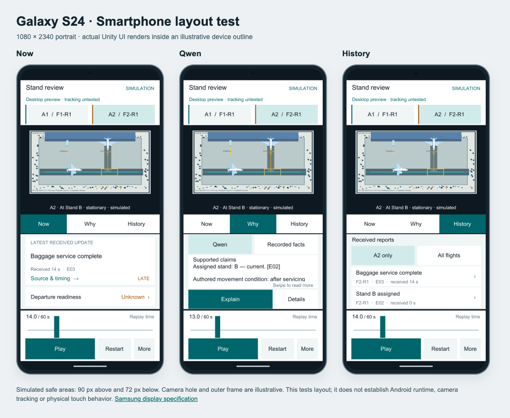
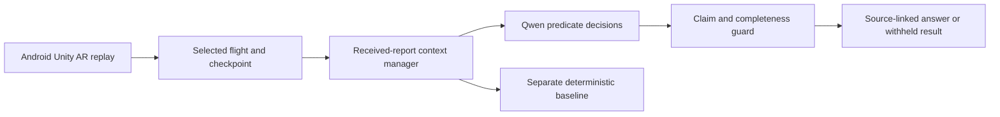

# Airfield Context AR

[](https://github.com/MayFairMI6/airfield-context-ar/actions/workflows/checks.yml)

An Android augmented reality prototype for reviewing changing aircraft-stand
coordination information. Select a flight, replay moving aircraft, inspect what
was known at a checkpoint, and trace each explanation to its received reports.
The intended stakeholder is a turnaround coordinator or ramp supervisor reviewing
stand activity, with training and debrief as secondary uses.

**This repository contains the full Unity application**, its local Qwen service,
synthetic datasets, and preserved evaluation records. The Android app places
original 3D aircraft over a printed fictional airfield board using Vuforia.



*Actual Unity renders in an illustrative Galaxy S24 outline. Physical phone,
keyboard and AR tracking tests remain pending.*

[Download Android APK](https://github.com/MayFairMI6/airfield-context-ar/releases/tag/v0.1.0)
· [Unity setup](docs/UNITY_SETUP.md)
· [Model and GitHub workflow](docs/MODEL_WORKFLOW.md)
· [Evaluation report](outputs/reasoning_v2/REPORT.md)

## What works

- Scripted aircraft motion with pause, restart, seek and tracking-loss gating.
- **Now / Why / History** views, selected-flight scope and source inspection.
- Separate event and receipt times: a delayed report appears only after receipt.
- Local Qwen evidence selection with exact source references and visible unknowns.
- Explicit current, latest and change-history query types in the backend/harness.
- A deterministic baseline displayed and evaluated separately from Qwen.
- Android ARM64 development build and simulated base Galaxy S24 layout checks.

The app currently has one authored M1 replay. Additional evaluation scenarios
run in the Python harness; there is no Android scenario picker yet. Coordination
updates are A-CDM-inspired, but no live airport/A-CDM feed is connected. This is a
fictional research prototype without movement authority or validated collision
protection. The benefit of AR over a conventional screen remains to be tested.

## Start with the Unity app

1. Clone this repository with GitHub Desktop or Git.
2. Install **Unity 6000.2.2f1**, Android Build Support, SDK/NDK and OpenJDK.
3. Obtain **Vuforia Engine 11.4.4** from its official distribution. Place the
   licensed package at `unity/SurfaceSafetyCoach/Packages/com.ptc.vuforia.engine-11.4.4.tgz`
   before opening the project. The package is excluded from Git.
4. Open `unity/SurfaceSafetyCoach` through Unity Hub. Add your own Vuforia
   application license in the Vuforia configuration; its local asset is ignored.
5. Open `Assets/SurfaceSafety/Scenes/DesktopReplay.unity` and press Play for a
   camera-free preview. For the phone, build `AndroidAR.unity` for Android.
6. Print [the original board](outputs/milestone1/Print-AirportBoard-24x16cm.png)
   at **24 × 16 cm**, without scaling, and measure it. The target width is 0.24 m.

The replay and recorded-fact views work without Qwen. For **Why → Qwen → Explain**,
start the Python service below. See [Unity setup](docs/UNITY_SETUP.md) for build,
phone networking and physical acceptance checks.

## Start the local model service

Verified development machine: Apple Silicon Mac, 48 GB memory, Python 3.12,
MPS float16. Qwen runs on the Mac; the smartphone is the AR interface. The
current engine chooses MPS when available and otherwise CPU; CUDA dispatch is
not implemented.

```sh
python3.12 -m venv .venv-qwen
source .venv-qwen/bin/activate
python -m pip install -r requirements-qwen.lock.txt
python scripts/download_qwen.py
bash scripts/start_qwen_server.sh
```

The downloader uses the exact revision in [config/model-manifest.json](config/model-manifest.json).
It does not follow the latest upstream model. Weights stay in ignored `models/`.
The service generates a local connection token in `work/qwen-server-token.txt`;
enter it through **More → Model connection**. Keep that token local.

For a phone on USB, use `adb reverse tcp:8765 tcp:8765` and the default service
address. For a trusted Wi-Fi connection, follow [QWEN_CONNECTION.md](QWEN_CONNECTION.md).

## How reasoning works



Code filters reports by receipt time and identity and supplies temporal status
labels. Qwen selects literal predicates through short Yes/No decisions; the
pipeline composes missing-evidence flags and projects exact values/source links
from the selected records. The guard withholds an incomplete or incorrect
selection; it never silently replaces it with a baseline answer.

The production report-query path uses text. A synthetic scene image is captured
for audit but supplies no service-state evidence. Multi-frame visual reasoning,
visually necessary tasks and longitudinal memory remain research extensions.
No model fine-tuning has been performed.

## Preserved evaluation

The method, model revision, data and source hashes were frozen before opening
32 fresh questions from eight separately authored synthetic scenario families.

| System on the same 32 questions | Exact answers | Missing-evidence cases | Change histories |
|---|---:|---:|---:|
| Original Qwen prompt | 9/32 | 0/12 | 0/8 |
| Revised Qwen hybrid pipeline | 31/32 | 12/12 | 8/8 |
| Separate deterministic baseline | 32/32 | 12/12 | 8/8 |

The remaining hybrid error added an unrelated stand claim to a route answer
and was withheld. Two missing-evidence successes used empty-context logic
without inference. Exact source/status copying is guaranteed by construction;
it is not learned citation or temporal-state inference. The schematic-image
condition scored 10/32. These results establish neither an advantage over the
deterministic baseline nor visual reasoning or operational reliability.

Read the [full report](outputs/reasoning_v2/REPORT.md),
[audit qualifications](outputs/reasoning_v2/audit-notes.json), and
[data provenance](data/reasoning_v2_fresh/README.md). Agent separation is not
external aviation-expert validation; questions within a family are correlated.
The legacy prompt also has a latest-event wording mismatch on receipt-time ties,
so this is a whole-system comparison. Raw failures, model decisions, baseline
results, frozen sources and previous development trials are retained.

## Tests and GitHub Actions

Fast checks need no Unity installation, model weights or GPU:

```sh
python3.12 -m venv .venv-ci
source .venv-ci/bin/activate
python -m pip install -r requirements-ci.txt
python -m unittest discover -s tests -v
python scripts/check_research_integrity.py
```

- **Checks:** runs backend regression tests and artifact-integrity checks on
  pushes and pull requests using a GitHub-hosted Linux runner.
- **Qwen development check:** manually dispatched on a configured Apple Silicon
  runner with cached weights. Choose two smoke cases or the 24-question development
  set; download results as an Actions artifact. This workflow does not run the
  fresh held-out set. A one-job Mac runner verified the first smoke run (2/2);
  it stopped and unregistered afterward. Register/start a Mac runner for future runs.
- Unity compilation, Android builds and camera tracking are outside the hosted
  Python check. Their local verification records are under `outputs/milestone1/`.

See [model workflow setup](docs/MODEL_WORKFLOW.md) and
[contributing](CONTRIBUTING.md), including GitHub Desktop instructions.

## Repository map

| Path | Contents |
|---|---|
| `unity/SurfaceSafetyCoach/` | Unity Assets, scenes, Packages manifests and ProjectSettings |
| `backend/` | Evidence state, model decisions, support checks and local API |
| `data/` | Fictional scenario families, questions, labels and dataset manifests |
| `scripts/` | Model installation, checks, evaluation and Android build helpers |
| `tests/` | Model-free regression and API contract tests |
| `outputs/reasoning_v1/`, `outputs/reasoning_v2/` | Preserved research records and frozen source snapshots |
| `outputs/milestone1/` | Screenshots, printable board and verification evidence |
| `config/model-manifest.json` | Exact model identity/revision; no weights |
| `docs/` | Unity, model-compute and collaboration setup |

Model weights, Python environments, Unity caches, license keys, connection
tokens, local runtime logs and APK binaries are excluded from Git history.
The APK is distributed through Releases. Vuforia/Unity and Qwen retain their
own terms; see [third-party notices](THIRD_PARTY_NOTICES.md). No open-source
license has yet been selected for the original project code.
